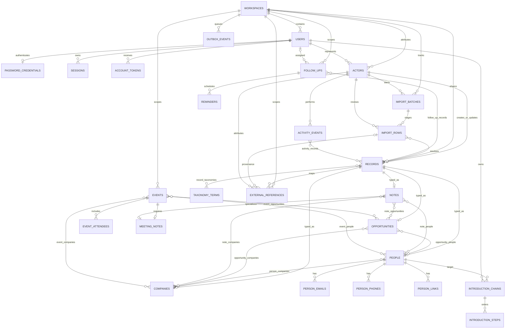

# Database foundation

PostgreSQL 17 schema for the shared Resoloon CRM workspace. The initial migration
is `migrations/001_core.sql`; Kysely-compatible database interfaces are in
`src/types.ts`.

## ERD (core)

All business objects use a `records` identity row for workspace, type, actor
attribution, archive/merge tombstone, timestamps, and optimistic `version`.
Typed tables share the identity UUID and have composite workspace foreign keys;
database triggers ensure the typed row matches `records.record_type`. Junctions
also carry the workspace key, preventing cross-workspace relationships.

## Apply migrations

Install workspace dependencies once from the repository root with `npm ci`.
Set `DATABASE_URL` to a PostgreSQL 17 database, then run `npm run migrate` from
the repository root (or this workspace). Each numbered SQL file is applied in its own transaction under a
PostgreSQL advisory lock. Applied files are SHA-256 checked; never edit an
applied migration—add the next numbered file. `002_import_tracking.sql` adds
workspace-scoped import staging and external source mappings; `003_workflows.sql`
adds local workflow storage; `004_address_country.sql` adds raw/display country
labels to person and company addresses; `005_taxonomy_settings.sql` adds
taxonomy display and ordering settings; `006_undoable_workflow_actions.sql` adds
short-lived, actor-attributed workflow undo snapshots. The runner creates
`public.schema_migrations`.

## Mutation and security contracts

- Generate setup/reset/session tokens in the application and persist only their
  32-byte SHA-256 hashes. `password_credentials` stores a scrypt hash, separate
  random salt, and versioned parameters; never store plaintext credentials.
- Create one `USER` actor per user. Non-user actors use `SYSTEM`, `INTEGRATION`,
  `MCP_CLIENT`, or `IMPORT` plus a stable `external_actor_key`; set
  `owner_user_id` when automation is owned by a user. The key intentionally
  leaves room for integration/client/import tables added in later slices.
- Create/update the `records` identity and typed row in the same transaction.
  For optimistic edits, lock or conditionally update the identity using
  `WHERE id = $id AND workspace_id = $workspace AND version = $expected`, set
  `version = version + 1`, `updated_at`, and `updated_by_actor_id`, and require
  exactly one returned row. Write the matching `activity_events` (and
  `activity_records`) and any `outbox_events` in that same transaction. A
  zero-row update is a conflict. The database requires every identity-row
  update to increment the version by exactly one but does not increment it
  automatically: callers must perform the version check in the same transaction
  as the business mutation.
- Activity rows and record identities cannot be hard-deleted; archive or merge
  records instead. Keep activity diffs small and exclude note bodies, email
  content, tokens, and credentials. Outbox payloads must not contain secrets.
- User emails are case-insensitively unique per workspace. Contact email/domain
  normalization (including IDNA and URL canonicalization) is performed by the
  application and stored in the corresponding normalized columns. Partial unique
  indexes block duplicate active email identities, E.164 phones, domains, and
  canonical links.
- Address `country_code` stores the ISO alpha-2 code; nullable `country_name`
  preserves the raw/display country label needed by legacy imports.
- Taxonomy terms remain unique by workspace, taxonomy, and normalized label.
  Their display settings include a validated six-digit hex `color` (default
  `#6B8E7C`), optional description, active flag, and sort order. Defaults keep
  existing taxonomy upserts that omit these fields compatible.
- Import batches are idempotently identified by workspace, import type, and the
  SHA-256 digest of the original source bytes (stored as 32-byte `bytea`, not a
  filename hash). On a uniqueness conflict, reuse the existing batch rather than
  creating duplicate staging rows. `import_rows.row_number` is one-based and
  unique within its batch; raw source data and provenance are immutable, while
  normalized values, issues, review decisions, target records, batch status, and
  current outcome counts can progress. The outcome counters are disjoint current
  row buckets and their total cannot exceed `total_rows`. Batch and row history
  cannot be hard-deleted.
- `external_references` provides a stable unique mapping per workspace/source
  system/object type/external ID (source system and object type use lowercase
  canonical names). Its record, actor, and optional import-row provenance links
  are workspace-scoped; mappings can be retargeted during a record merge, but
  their source identity and origin cannot be rewritten.
- Events use independent workspace-scoped IDs rather than consuming core record
  types. `source` distinguishes local events from synchronized read-only
  events without introducing Google account, cursor, or provider-object tables.
  Attendees support internal/user and CRM-person matching plus an explicit
  review state. Event relationships use separate typed junctions to people,
  companies, and opportunities.
- `meeting_notes` specializes a core `notes` row of type `MEETING`, uniquely
  associates it with an event, and records required/completed/cancelled state.
  Completion and cancellation are actor-attributed; cancellation requires a
  reason. Notes remain normal core records for timelines and activity.
- Follow-ups have `OPEN`, `COMPLETED`, or `CANCELLED` status, optional user
  assignee, source metadata, and workspace-scoped relationships to core records.
  Event and meeting-note source links are explicit where applicable. Reminders
  are uniquely scheduled per follow-up/time and retain their delivery or
  dismissal state.
- Undoable follow-up/meeting-note status actions store before/after JSON object
  snapshots and expire after five minutes by default. Actions and consumers are
  attributed to workspace-scoped actors; consumed timestamp and actor must be
  set together. `target_id` is intentionally polymorphic and has no target FK.
- Introduction chains point to a target person and owner; step positions are
  unique within each chain and each step references its people/responsible actor.
  The current step is derived as the first nonterminal step, avoiding a stale
  duplicated pointer. Completion/cancellation uses state metadata where
  defined; synchronized events, meeting notes, and reminders cannot be
  hard-deleted. Local event/follow-up/chain deletions remain auditable through
  append-only activity events.
- Events and follow-ups are not `records`. For their activity entries, leave
  `activity_events.primary_record_id` null and attach only actual related core
  record IDs through `activity_records`; meeting-note activity can use its note
  record as primary. Activity attribution is carried by `activity_events`; the
  workflow rows also accept workspace-scoped actor attribution where supplied.
  No Google or Linear synchronization internals are defined.

This slice covers core CRM records, notes/taxonomies, identity, activity,
transactional outbox, import tracking, and local events/follow-ups/reminders/
introductions. Google and Linear synchronization internals, email, integration
credentials, MCP-client administration, search projections, and operations are
later schema slices.
